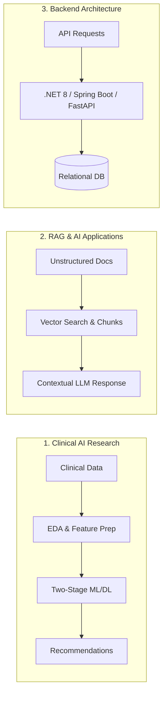

# Hasret Irmak BARAN

### AI Systems & Software Engineer &bull; Applied Machine Learning Researcher

  <em>Software Engineering graduate building practical AI systems, RAG pipelines, and enterprise backend architectures with an active continuous-learning mindset.</em>

---

## 👨‍💻 About Me & Engineering Philosophy

I am a Software Engineering graduate driven by solving real-world challenges through data, machine learning, and clean backend engineering. As the **primary author of a peer-reviewed book chapter published by Springer Nature**, I combine analytical research methodology with hands-on application development.

- 🧠 **RAG & Practical AI Systems:** Designing Retrieval-Augmented Generation (RAG) pipelines, semantic document search, embedding-based retrieval, and integrating LLMs into functional decision workflows.
- 🔬 **Applied Machine Learning:** Practical experience across the entire ML workflow: Exploratory Data Analysis (EDA), feature engineering, handling imbalanced datasets, and model benchmarking.
- ⚡ **Deep Learning Architectures:** Implementing neural models (CNN, RNN, LSTM, ANN/FNN) for classification and sequence-based predictive tasks.
- 🏛️ **Enterprise Backend & Systems:** Developing structured RESTful Web APIs using **ASP.NET Core (.NET 8)**, **Spring Boot**, and **FastAPI**, with containerization via Docker.
- 📈 **Continuous Growth:** Actively expanding my problem-solving depth in **Data Structures & Algorithms (DSA)** and learning modern **CI/CD automation** best practices.

---

## 📚 Academic Research & Publications

### 📖 Springer Nature: [Guideline-Concordant Two-Stage AI for Diabetes Severity Stratification and Pharmacotherapy Recommendation](https://link.springer.com/chapter/10.1007/978-3-032-07267-2_11)

- **Authors:** **Hasret Irmak Baran** *(Primary / 1st Author)*, Nisa Sahinoglu, Gulay Cicek
- **Book:** *Next-Gen Healthcare*, Springer Nature (2026) &bull; **DOI:** `10.1007/978-3-032-07267-2_11`
- **Key Methodology:** A two-stage intelligent clinical framework combining data-driven cross-validated models (LSTM, Random Forest, SVM) with rule-based treatment algorithms for disease stratification and patient-specific drug recommendation.

### 📄 ResearchGate: [Use of Classification Algorithms in the Determination of Diabetes Level and Drug Recommendation Process](https://www.researchgate.net/publication/392618293_Use_of_Classification_Algorithms_in_the_Determination_of_Diabetes_Level_and_Drug_Recommendation_Process)

- **Author:** **Hasret Irmak Baran** *(1st Author)*
- **Focus:** Supervised classification architectures, clinical feature selection, data balancing, and therapeutic outcome prediction.

---

## 🛠️ Technical Toolkit

| Category | Skills & Technologies |
| :--- | :--- |
| **Languages** | Python, C# (.NET 8), Java, C++, SQL, TypeScript |
| **Generative AI & RAG** | Retrieval-Augmented Generation (RAG), Vector Embeddings, Semantic Search, Document Chunking, Prompt Design |
| **Machine Learning** | XGBoost, LightGBM, CatBoost, Random Forest, SVM, KNN, Logistic Regression, Scikit-Learn |
| **Deep Learning** | CNN, RNN, LSTM, ANN / FNN, Neural Architectures, PyTorch |
| **Data Analysis & Preprocessing** | Exploratory Data Analysis (EDA), Feature Engineering, Data Cleaning, Class Imbalance Handling, Pandas, NumPy |
| **Backend & Databases** | ASP.NET Core Web API, Spring Boot, FastAPI, Entity Framework Core, PostgreSQL, SQLite |
| **DevOps & Active Focus** | Docker, Docker Compose, Linux, Git &bull; *Actively developing skills in: CI/CD (GitHub Actions) & DSA Optimization* |

---

## 🏛️ Featured Engineering Projects

### 🧬 1. Clinical AI Decision Support System

*Companion codebase for the Springer Nature research publication.*

- Two-stage predictive framework for disease severity stratification and guideline-concordant drug recommendations.
- Implements ensemble methods (Random Forest, XGBoost, CatBoost), Logistic Regression baselines, and Recurrent Neural Networks (LSTM).
- End-to-end data pipeline: statistical feature selection, handling cohort imbalances, and clinical interpretability.

### ⚡ 2. Enterprise RAG & Document Intelligence System

*Retrieval-Augmented Generation application for semantic knowledge retrieval.*

- Document ingestion and semantic chunking pipeline generating vector embeddings for context-aware search.
- Mitigates LLM hallucinations by injecting verified context windows into prompts before inference.
- Containerized execution environment using Docker Compose.

### 🛡️ 3. IntelSphere - Threat Intelligence API

*RESTful Web API for cybersecurity breach source monitoring and domain risk indexing.*

- Built with ASP.NET Core (.NET 8) using Entity Framework Core and Clean Architecture principles.
- Decoupled controllers, DTOs, automated migrations, and interactive Swagger/OpenAPI documentation.
- Database abstraction supporting SQLite for local testing and PostgreSQL for deployment.

---

## 🎯 Active Growth & Continuous Learning

- 💡 **Algorithmic Problem Solving:** Actively practicing Data Structures & Algorithms (LeetCode / DSA) to sharpen time and space complexity analysis.
- ⚙️ **CI/CD & DevOps Practices:** Actively building automated GitHub Actions workflows for continuous integration, code quality checks, and container deployment.
